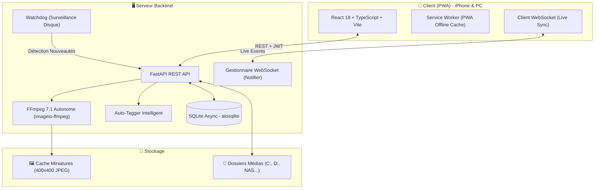

<div align="center">

# 🔒 MediaVault

### *Self-Hosted Personal Media Server & PWA with a Social Twist*

[](https://fastapi.tiangolo.com)
[](https://react.dev)
[](https://www.typescriptlang.org)
[](https://vitejs.dev)
[](https://tailwindcss.com)
[](https://developer.mozilla.org/en-US/docs/Web/Progressive_web_apps)
[](https://opensource.org/licenses/MIT)

<p align="center">
  <b>Instagram-Style Feed</b> • <b>TikTok-Style Reels</b> • <b>Plex/Jellyfin-Style Multi-Folder Manager</b> • <b>Real-Time Auto-Sync</b> • <b>Installable PWA</b>
</p>

[Fonctionnalités](#-fonctionnalités-clés) • [Architecture](#-architecture) • [Démarrage Rapide](#-démarrage-rapide) • [Accès Mobile & Tailscale](#-accès-mobile--tailscale) • [Raccourcis Clavier](#-raccourcis-clavier)

</div>

---

## 💡 Présentation

**MediaVault** est une application web progressive (PWA) auto-hébergée conçue pour centraliser, explorer et lire vos photos, vidéos et notes personnelles depuis n'importe quel appareil (PC, iPhone, Android, Homelab).

Inspirée du meilleur des réseaux sociaux modernes :
- **Un feed carré élégant** inspiré d'Instagram pour survoler des milliers de souvenirs.
- **Un lecteur vertical plein écran immersif** inspiré de TikTok / Reels avec autoplay, gesture controls et double-tap pour liker ❤️.
- **Un gestionnaire multi-emplacements** à la Plex / Jellyfin pour indexer plusieurs disques durs (`C:\`, `D:\`, SSD externes, NAS).
- **Une synchronisation temps réel sans rafraîchissement** grâce à un watcher de fichiers en arrière-plan et des WebSockets.

---

## ✨ Fonctionnalités Clés

### 📱 1. Lecteur Reels vertical immersif (TikTok-Style)
- **Scroll Snap Vertical** : Chaque média occupe 100% de la hauteur avec transition fluide.
- **Autoplay Dynamique** : La vidéo démarre à l'écran et se met en pause dès que vous faites défiler la page.
- **Contrôles gestuels** :
  - Double-tap au centre pour liker ❤️ (sans mettre la vidéo en pause), à gauche / à droite pour reculer / avancer de 5s.
  - Simple tap pour Play/Pause ⏸.
  - Bouton Fit/Zoom (↔️ / 🔍) pour basculer entre mode plein écran rogné ou centré.
  - Mémoire du son : activez-le une fois, il reste actif pour les vidéos suivantes et au prochain lancement.
- **Filtres** : 📱 Verticales (format portrait uniquement), 🎬 Toutes les vidéos, 🌐 Photos + vidéos.
- **Mode aléatoire 🔀** : ordre mélangé, stable pendant le défilement.
- **Cadrage automatique** : une vidéo verticale remplit l'écran d'un téléphone, une vidéo horizontale est affichée en entier.
- **Léger sur iPhone** : seuls la vidéo affichée et ses deux voisines sont chargées ; la suivante est préchargée pour un swipe instantané.
- **Vidéos de téléphone** : l'orientation est lue depuis les métadonnées de rotation (les vidéos déjà indexées sont réanalysées une fois au démarrage).
- **Barre latérale d'actions** : Accès rapide aux infos de résolution, durée, poids, bouton favoris et téléchargement direct.

### 🖼️ 2. Feed Grille Moderne (Instagram-Style)
- Grille carrée responsive 3 à 5 colonnes.
- Filtres rapides par type : **Tout**, **📷 Photos**, **🎬 Vidéos**, **📄 Textes**.
- Tri instantané : Plus récents, plus anciens, ordre alphabétique, taille de fichier.
- Sélecteur de bibliothèque : Filtrez vos médias par dossier source ou affichez tout en unifié.

### 📁 3. Gestionnaire de Bibliothèques (Plex / Jellyfin-Style)
- **Multi-dossiers** : Ajoutez autant de répertoires que vous voulez sur n'importe quel disque (`C:\`, `D:\`, disques réseau).
- **Explorateur visuel intégré** : Parcourez les disques du serveur et sélectionnez vos dossiers en quelques clics.
- **Statut de connexion en direct** : Visualisez l'accessibilité de vos lecteurs (🟢 Connecté, 🔴 Introuvable) et les compteurs de fichiers par format.

### ⚡ 4. Surveillance Temps Réel & Auto-Tagging
- **File Watcher autonome** (`watchdog`) : Dès qu'une vidéo ou photo est ajoutée, copiée ou supprimée dans vos dossiers surveillés, MediaVault l'indexe en moins de 2 secondes.
- **Mise à jour en direct via WebSocket** : Aucun rafraîchissement nécessaire sur votre smartphone ou votre PC.
- **Tags intelligents automatiques** :
  - `#vertical` (format Reels/TikTok 9:16)
  - `#widescreen` (format paysage 16:9)
  - `#short` (vidéos de moins de 60s)
  - `#hd` et `#4k` (selon la résolution)
  - `#capture` (détection de screenshots)
  - `#gaming` (clips Discord, GeForce Experience, replays)

### 🏷️ 5. Albums & Organisation
- Création d'albums manuels personnalisés avec vignettes de couverture automatiques.
- Collections automatiques intelligentes (Toutes les photos, Toutes les vidéos, Favoris, Notes).
- Ajout à un album ou étiquetage direct depuis la visionneuse plein écran.

### 🌐 6. Expérience PWA & Streaming iOS Safari
- Installable sur l'écran d'accueil iPhone et Windows en mode application native (zéro barre d'adresse navigateur).
- Support complet des en-têtes **HTTP 206 Partial Content (Range requests)** pour un streaming instantané et un scrubbing vidéo ultra-fluide sur iOS Safari.

---

## 🏗️ Architecture



---

## 🛠️ Stack Technique

| Domaine | Technologies |
|---|---|
| **Backend** | Python 3.11+, FastAPI, Uvicorn, SQLAlchemy 2.0 (Async), SQLite + aiosqlite |
| **Traitement Média** | FFmpeg 7.1 intégré (`imageio-ffmpeg`), Pillow (PIL) |
| **Surveillance Disque** | Watchdog (FileSystemEventHandler avec debounce) |
| **Temps Réel** | WebSockets asynchrones natifs |
| **Frontend** | React 18, TypeScript, Vite, Tailwind CSS, Framer Motion |
| **Gestion d'État & Cache** | TanStack Query v5 (React Query), Zustand |
| **Mobile & PWA** | vite-plugin-pwa, Service Workers, Web App Manifest |

---

## 🚀 Démarrage Rapide

### Prérequis
- **Python 3.11+**
- **Node.js 18+** & npm

### 1. Cloner le projet
```bash
git clone https://github.com/ArthureCodage/MediaVault.git
cd MediaVault
```

### 2. Configuration du Backend
```bash
cd backend
python -m venv .venv
.\.venv\Scripts\activate   # Sur Windows (source .venv/bin/activate sur Linux)
pip install -r requirements.txt
```

Créez votre fichier `backend/.env` (ou copiez `backend/.env.example`) :
```ini
MEDIA_DIR=C:\Users\DonoM\Pictures    # Dossier média initial
SECRET_KEY=change-this-secret-key-12345
APP_USERNAME=admin                    # Votre identifiant
APP_PASSWORD=admin                    # Votre mot de passe
```

> ⚠️ **Changez `SECRET_KEY` et `APP_PASSWORD`** avant d'exposer l'appli (Tailscale, réseau local). Le backend affiche un avertissement au démarrage tant qu'ils gardent leur valeur par défaut. Pour générer une clé : `python -c "import secrets; print(secrets.token_urlsafe(32))"`

Lancez le backend :
```bash
python -m uvicorn app.main:app --host 0.0.0.0 --port 8000 --reload
```

### 3. Configuration du Frontend
```bash
cd ../frontend
npm install
npm run dev -- --host 0.0.0.0
```

### 4. Démarrage en 1 clic (Windows)
Double-cliquez simplement sur **`start-all.bat`** à la racine pour lancer automatiquement le serveur backend et l'interface frontend !

### 5. Avec Docker (Linux / homelab)
Créez un fichier `.env` à la racine (à côté de `docker-compose.yml`) :
```ini
APP_PASSWORD=un-vrai-mot-de-passe
SECRET_KEY=une-longue-cle-aleatoire
MEDIA_PATH=/chemin/vers/vos/medias
```
Puis :
```bash
docker compose up -d --build
```
Le frontend est servi sur le port `5173`, l'API sur `8000`. Les médias sont montés en lecture seule (retirez `:ro` dans `docker-compose.yml` pour autoriser l'upload).

### 6. Tests
```bash
cd backend
pip install -r requirements-dev.txt
python -m pytest -q tests
```

---

## 📱 Accès Mobile & Tailscale

Pour accéder à MediaVault partout depuis votre iPhone ou smartphone :

1. Installez et connectez **Tailscale** sur votre PC et votre téléphone (ou connectez-vous au même réseau Wi-Fi).
2. Ouvrez **Safari** sur iPhone et entrez :
   ```
   http://<VOTRE-IP-TAILSCALE>:5173
   # ou http://192.168.2.10:5173 en réseau local
   ```
3. Connectez-vous avec les identifiants définis dans `backend/.env`.
4. Dans Safari, appuyez sur le bouton **Partager** (carré avec flèche vers le haut) et sélectionnez **"Sur l'écran d'accueil"**.
5. MediaVault s'ouvre désormais en plein écran comme une véritable application native iOS !

---

## ⌨️ Raccourcis Clavier (Desktop)

| Contexte | Touche | Action |
|---|---|---|
| **Reels (TikTok)** | `↓` ou `J` | Reel suivant |
| **Reels (TikTok)** | `↑` ou `K` | Reel précédent |
| **Reels (TikTok)** | `Espace` | Play / Pause |
| **Reels (TikTok)** | `M` | Couper / Activer le son |
| **Reels (TikTok)** | `L` | Liker le média ❤️ |
| **Visionneuse Plein Écran** | `→` | Photo/Vidéo suivante |
| **Visionneuse Plein Écran** | `←` | Photo/Vidéo précédente |
| **Visionneuse Plein Écran** | `Échap` | Fermer |

---

## 📄 Licence

Ce projet est sous licence [MIT](LICENSE). Libre d'utilisation, de modification et de distribution.
